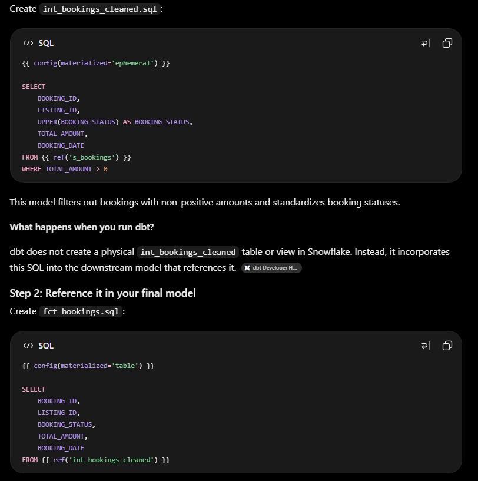

What are ephemeral models in dbt?
An ephemeral model is a dbt model whose SQL is not materialized as a separate table or view in the database. Instead, dbt injects its SQL into the SQL of another model that references it, typically using a CTE (Common Table Expression).

In simple terms:
- Table model: Creates a physical table in Snowflake.
- View model: Creates a view in Snowflake.
- Ephemeral model: Creates neither; its SQL is incorporated into the downstream model's query.
Think of an ephemeral model as a reusable SQL transformation that exists in dbt's project but does not become a standalone database object.
2. Example using your Airbnb project
Suppose you have these three models:
- s_bookings.sql
- s_listings.sql
- s_hosts.sql
You want to clean booking data before using it in your final model.

BASIC OVERVIEW:
so what i understood is if we mention the materilized as ephemeral then it neither creates tables nor views in database instead SQL code from your ephemeral model and inserting it into the SQL code of the model that references it and  like a cte in dbt itself and we can use this ephemeral table with any other query 