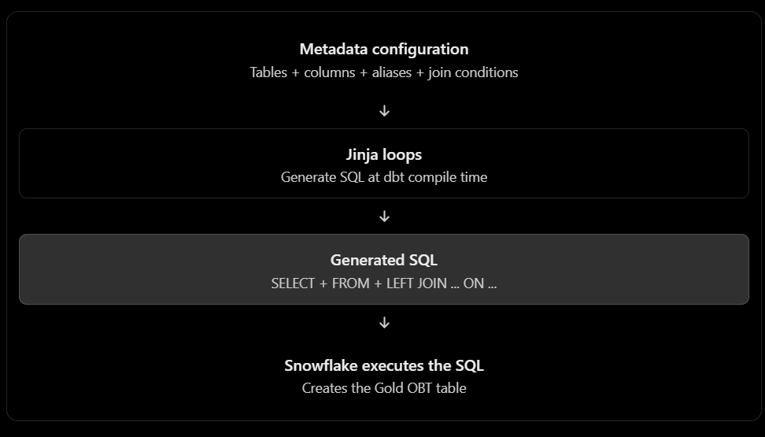

The central idea is:

Instead of manually writing a large SQL query that joins Bookings, Listings, and Hosts, you store the table and join information in a configuration, then let dbt generate the SQL automatically.That's what “metadata-driven” means here. The configuration describes what to join, and a Jinja loop generates how to join it.
These tables hold related information, but the information is separated. For example, a booking has a LISTING_ID, and that listing has a HOST_ID.If an analyst wants to answer, “Which cities generate the most booking revenue, and how does host status affect it?”, they need information from all three tables.

What is an OBT (One Big Table)?
An OBT combines the related information into one wide, denormalized table, so analysts can query it without writing joins every time.

Why is it called metadata-driven?
Traditional approach: hardcode the joins
This works. But imagine adding more tables or changing which columns you select. You need to keep editing the SQL.
Metadata-driven approach: describe the joins in a configuration
Instead, you define a Jinja configuration containing each table, its alias, the columns to select, and its join condition.Then Jinja loops over the configuration to generate the SQL.

The benefit is that you can change the configuration to add a table or adjust its selected columns and join condition, without rewriting the entire join-generation pattern. You still need to define the correct join keys and column mappings.